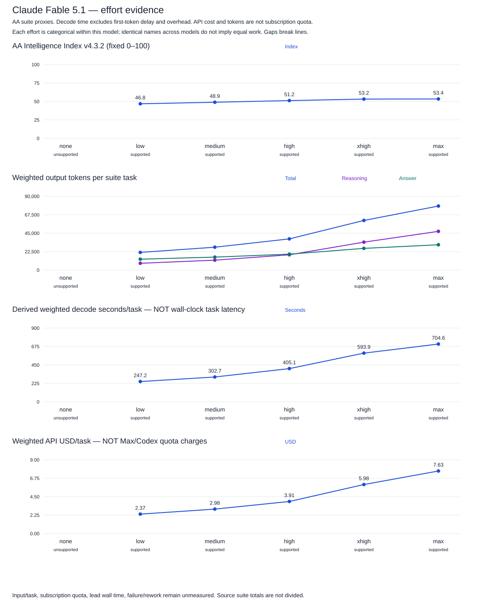
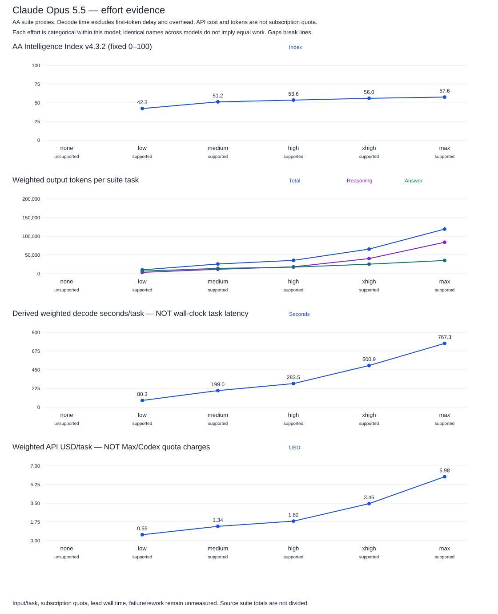
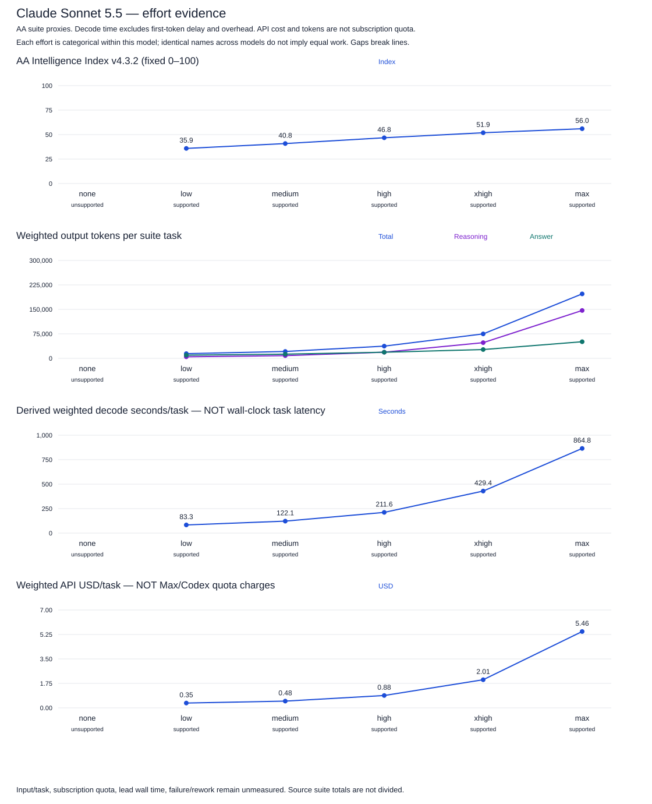
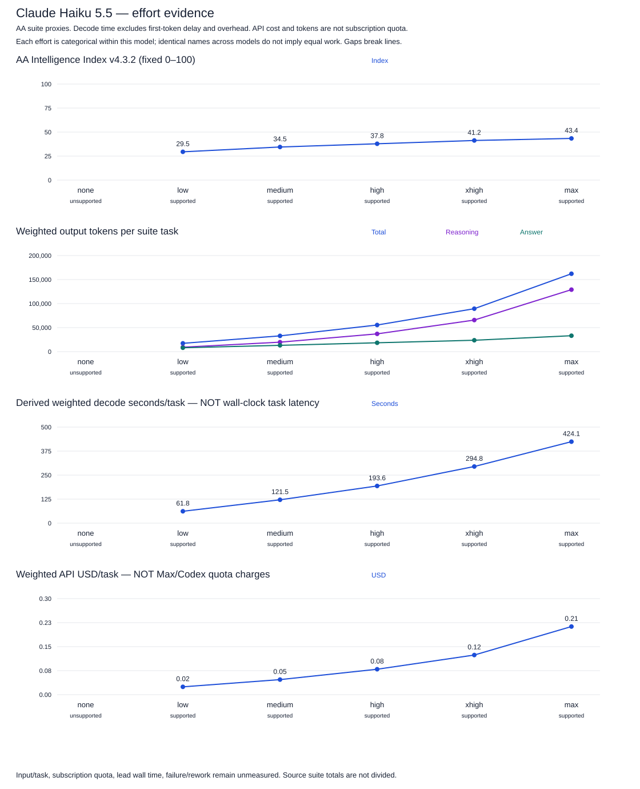
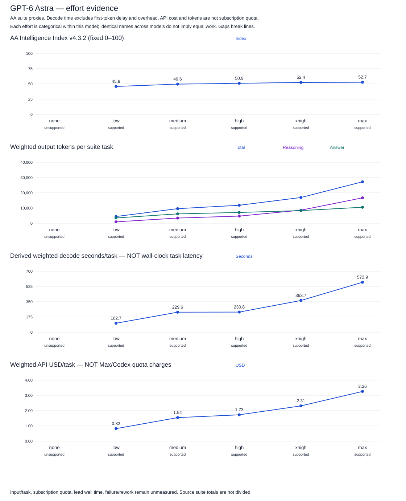
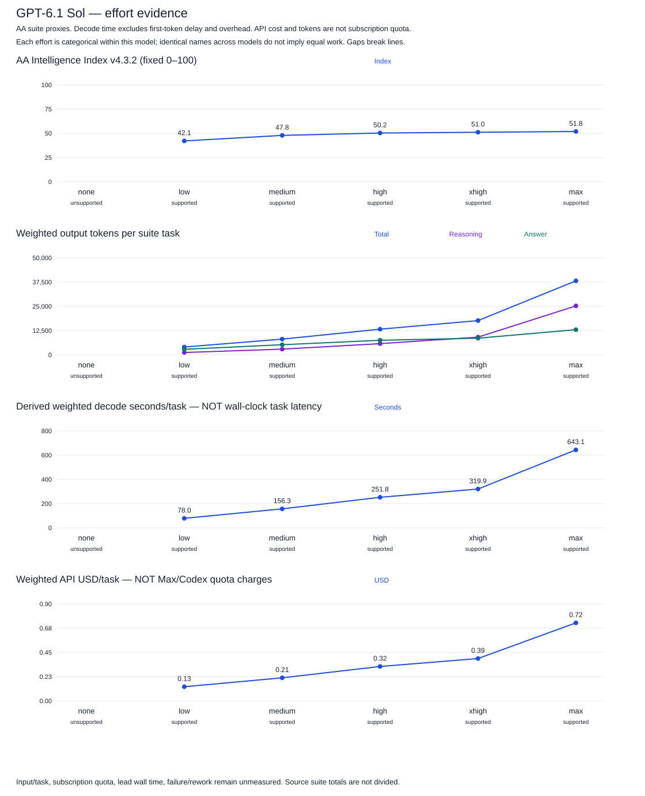
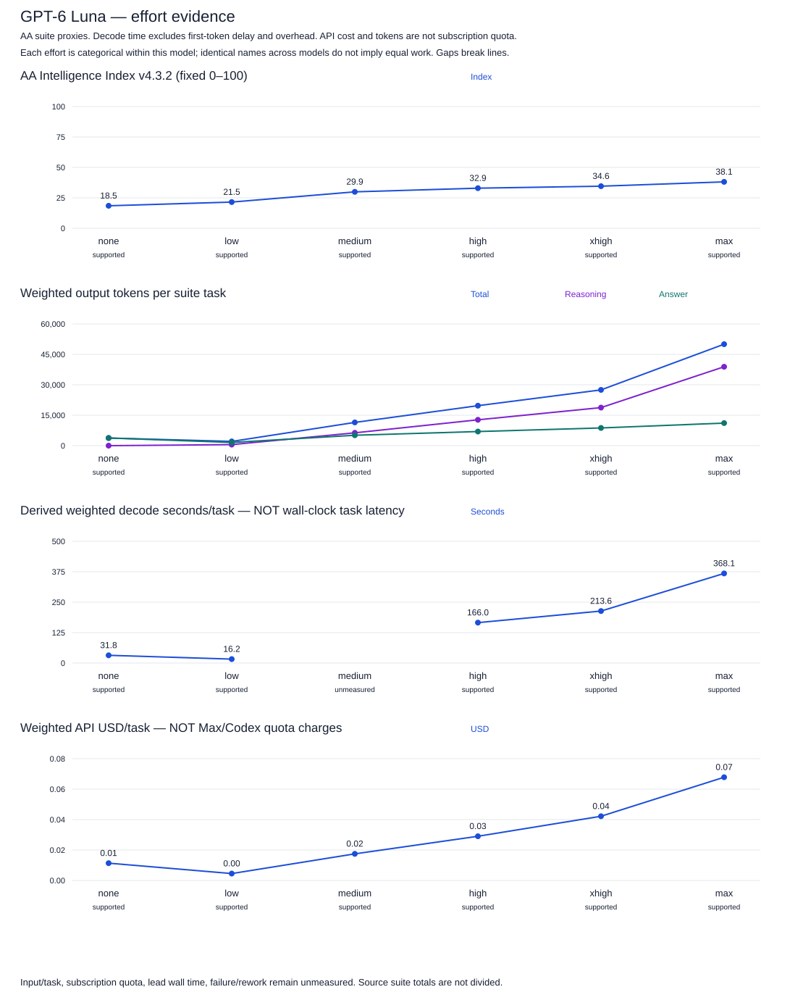
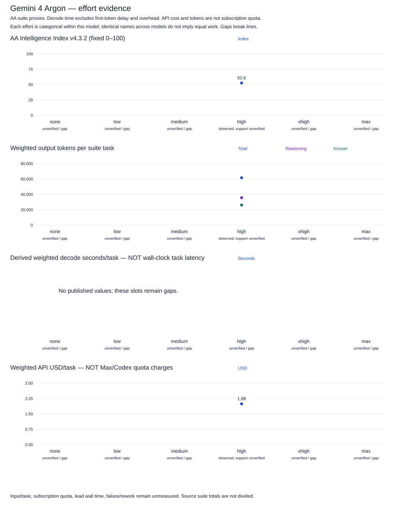
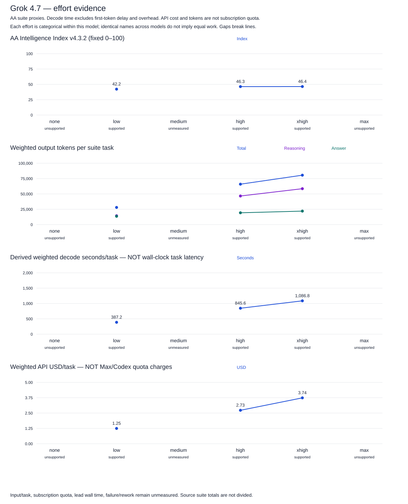

# Effort curves

One model per figure, with categorical none/low/medium/high/xhigh/max slots. Lines only join adjacent measured categories; they are visual guides, not interpolation or monotonic fits. Quality uses the original fixed 0–100 AA index, never each model’s best score as a denominator.

[Complete tuple values and method flags](effort-curves.csv) · [Evidence JSON](../../data/benchmarks/efforts.json) · [Source definitions](../../data/benchmarks/SOURCES.md)

API-documented effort support is separate from local CLI flag/account verification. Gemini/Grok runtimes remain planned. Argon high is an AA observed setting; its complete publisher effort matrix is unverified. Unsupported, supported-but-unmeasured, and unverified settings remain visible.

AA output/reasoning/answer tokens per task are benchmark-weighted suite measurements. Raw canonical suite totals are retained in JSON; input/task is not inferred from an unknown denominator. Decode time is a source-derived estimate from output-token use and speed, weighted across benchmarks; it excludes first-token delay and overhead. It is neither elapsed task latency nor a 12-minute lead-research measurement.

API USD/task incorporates token prices and caching assumptions. It is not Claude Max/Codex subscription quota. Subscription quota, failure/rework, input/task and lead wall time remain null pending calibration. The plan’s quality bands and expected-total-cost choices are outside this reporting code.

| Model | API-supported settings | AA observations | Decode-time observations |
|---|---|---:|---:|
| claude-fable-5-1 | low, medium, high, xhigh, max | 5 | 5 |
| claude-opus-5-5 | low, medium, high, xhigh, max | 5 | 5 |
| claude-sonnet-5-5 | low, medium, high, xhigh, max | 5 | 5 |
| claude-haiku-5-5 | low, medium, high, xhigh, max | 5 | 5 |
| gpt-6-astra | low, medium, high, xhigh, max | 5 | 5 |
| gpt-6.1-sol | low, medium, high, xhigh, max | 5 | 5 |
| gpt-6-luna | none, low, medium, high, xhigh, max | 6 | 5 |
| gemini-4-argon | full matrix unverified | 1 | 0 |
| grok-4.7 | low, medium, high, xhigh | 3 | 3 |

## Claude Fable 5.1

## Claude Opus 5.5

## Claude Sonnet 5.5

## Claude Haiku 5.5

## GPT-6 Astra

## GPT-6.1 Sol

## GPT-6 Luna

## Gemini 4 Argon

## Grok 4.7

